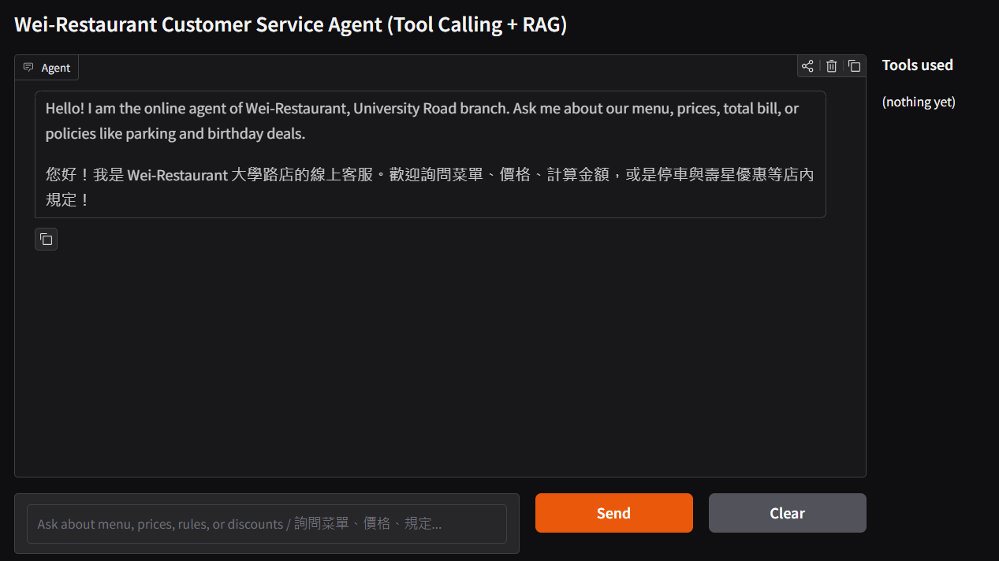
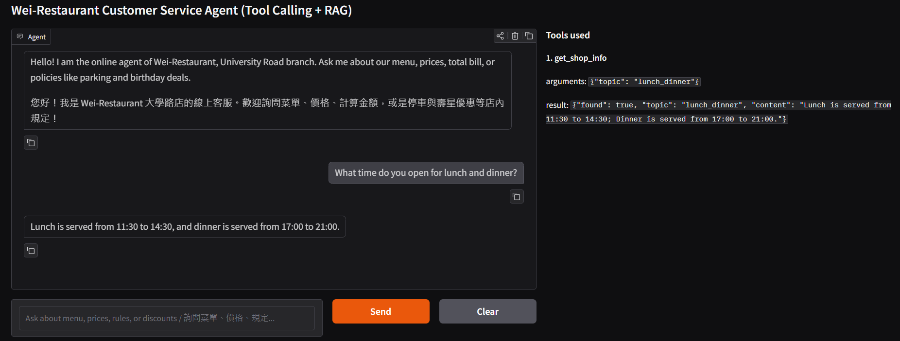
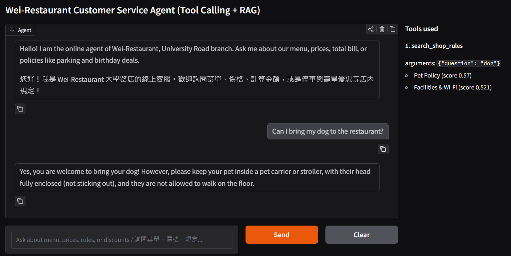
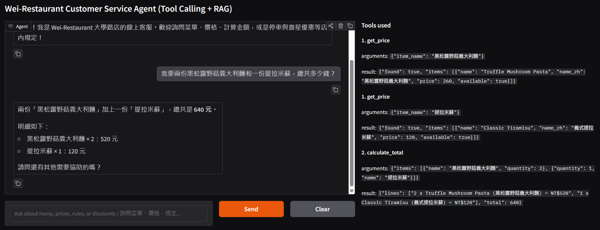
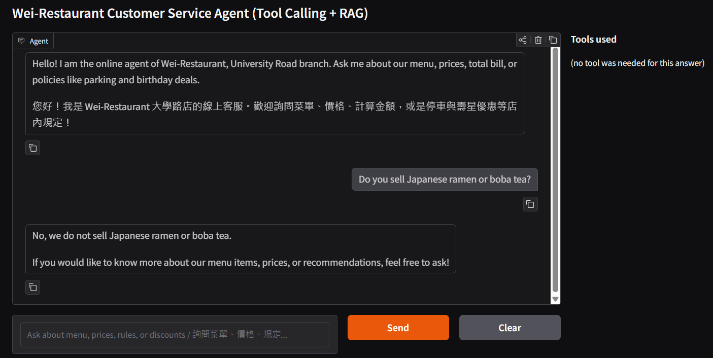

# Wei-Restaurant Customer Service Agent: An Online AI Agent with Tool Calling & RAG

Wei-Restaurant Customer Service Agent is an AI-powered online customer service agent for **Wei-Restaurant** (University Road branch), an Italian and European bistro. It helps guests query menu items, check prices, verify business hours, retrieve store policies/rules via **RAG (Retrieval-Augmented Generation)**, calculate order totals, and hand over complex requests or complaints to human staff using real-time function calling backed by an SQLite database and vector semantic search.



## Who It Serves and When They Use It

- **Who uses it:** Diners, students, and local guests who want to query the menu, check operating hours, review store policies, or calculate dinner costs before visiting Wei-Restaurant.
- **When they use it:** Any time of day or night, especially outside business hours when restaurant staff are unavailable to answer calls.
- **What problem it solves:** Eliminates long phone wait times for routine questions (e.g., last call time, student discounts, pet policies, parking validation, or menu prices) and removes manual calculation errors for complex orders.
- **Why it is better:** Unlike static FAQ pages or generic chatbots like ChatGPT that often hallucinate prices or policies, this agent strictly grounds its answers in a verified SQLite database and vector RAG store via structured Function Calling, ensuring 100% accurate information, exact bill calculations, and precise policy lookups.

## What It Can Do

| Function | Example Question | Tool It Uses |
|---|---|---|
| Query business hours & shop info | "What time do you serve lunch and dinner?" / "你們午餐和晚餐時間幾點到幾點？" | [`get_shop_info`] |
| Search menu items & pricing | "Is the Bacon Carbonara available today?" / "奶油培根蛋黃麵今天有供應嗎？" | [`get_price`] |
| Search store policies & rules (RAG) | "Can I bring my dog to the restaurant?" / "請問可以帶寵物用餐嗎？" | [`search_shop_rules`] |
| Calculate exact bill total | "I want 2 Truffle Mushroom Pastas and a Classic Tiramisu. How much is it?" / "我要兩份黑松露野菇義大利麵和一份提拉米蘇，總共多少錢？" | [`calculate_total`] |
| Honest refusal for off-menu items | "Do you sell Japanese ramen or boba tea?" / "你們店裡有賣日式拉麵或珍珠奶茶嗎？" | [`get_price`] |
| Hand over to human staff | "My steak was served cold and the waiter was rude. I want to speak to a manager." / "剛才送來的餐點是冷的，我要找經理投訴！" | [`transfer_to_human`] |

## How It Works

Every question goes to the agent first. The agent chooses the appropriate tool based on user intent. The Python functions execute database queries, vector similarity searches (RAG), or exact arithmetic, and the agent formulates polite, concise responses (under 3 sentences) strictly using the tool output.

- **Model:** `gemini-3.5-flash-lite` (via OpenAI-compatible API)
- **Embedding Model:** `gemini-embedding-001` (for RAG vector similarity search)
- **Chat Screen:** Gradio Web Interface (Supports Bilingual UI in English & Traditional Chinese)
- **Database (SQLite):** `shop_app.db`, automatically generated from CSV files on startup.

  | Table | CSV File | What It Holds | Rows |
  |---|---|---|---|
  | [`shop_info`] | [`shop_info.csv`] | Operating hours, lunch/dinner times, last order, address, phone, payment, set deals, student discount, delivery, parking | 10 topics |
  | [`menu`] | [`menu.csv`] | Menu item details: item ID, English name, Chinese name (`name_zh`), category, price (NT$), availability | 24 items |

- **RAG Knowledge Base:** `shop_rules.txt` (or built-in fallback chunks) chunked and indexed into text embeddings (`text-embedding-004`) for cosine similarity semantic search over store policies.

- **Tools:**

  | Tool | Kind | What It Reads or Calculates | Parameters |
  |---|---|---|---|
  | [`get_shop_info(topic)`] | Look up information | Reads specific topic content from `shop_info` | `topic` (enum of 10 topics) |
  | [`get_price(item_name)`] | Look up records | Fuzzy matches English/Chinese item names in `menu` | `item_name` (string) |
  | [`search_shop_rules(question)`] | RAG Vector Search | Cosine similarity search over store policies (pets, parking, discounts, Wi-Fi, corkage, bookings) | `question` (string) |
  | [`calculate_total(items)`] | Calculate in code | Sums `price × quantity` for all validated items | `items` (array of objects) |
  | [`transfer_to_human()`] | Hand over to person | Returns staff phone number and handoff instructions | None |

## Sample Conversations

### 1. In the Data (Querying Business Hours)
The agent calls `get_shop_info(topic="lunch_dinner")` to accurately inform the user about lunch and dinner serving hours.



### 2. Store Rules & Policies (RAG Search)
When asked about policies in English or Chinese (e.g., "Can I bring my dog to the restaurant?"), the agent executes `search_shop_rules` using vector search to retrieve relevant chunks (`Pet Policy`) and displays the matching score and chunk title in the right-hand trace panel matching the user's language.



### 3. Needs Maths (Order Calculation)
The agent queries prices using `get_price` for each item and then invokes `calculate_total` to perform exact Python arithmetic.



### 4. Not in the Data (Off-menu Inquiry / Honest Refusal)
When asked about items not on the menu (e.g., Japanese ramen or boba tea), the agent gracefully informs the guest that the item is not served at Wei-Restaurant without hallucinating fake menu items.

### 5. Not Our Job (Refusing Out-of-Scope Topics)
When asked about out-of-scope topics such as Kaohsiung's weather forecast, the agent politely declines per System Prompt rules and redirects to restaurant inquiries.



```text
Wei-Restaurant/
├── app_gradio.py       # Main application: SQLite setup, RAG indexing, tools, System Prompt, agent loop, Gradio UI
├── shop_info.csv       # Information table source (10 topics)
├── menu.csv            # Menu table source (24 food & drink items)
├── requirements.txt    # Required Python packages (gradio, openai, python-dotenv, numpy)
├── .env.example        # Environment variable template (MODEL_NAME, EMBEDDING_MODEL_NAME, API_KEY, LLM_API_URL)
├── .gitignore          # Git ignore rules (.env, *.db, __pycache__)
├── images/             # Screenshots for README and course report
└── README.md           # Project documentation
```